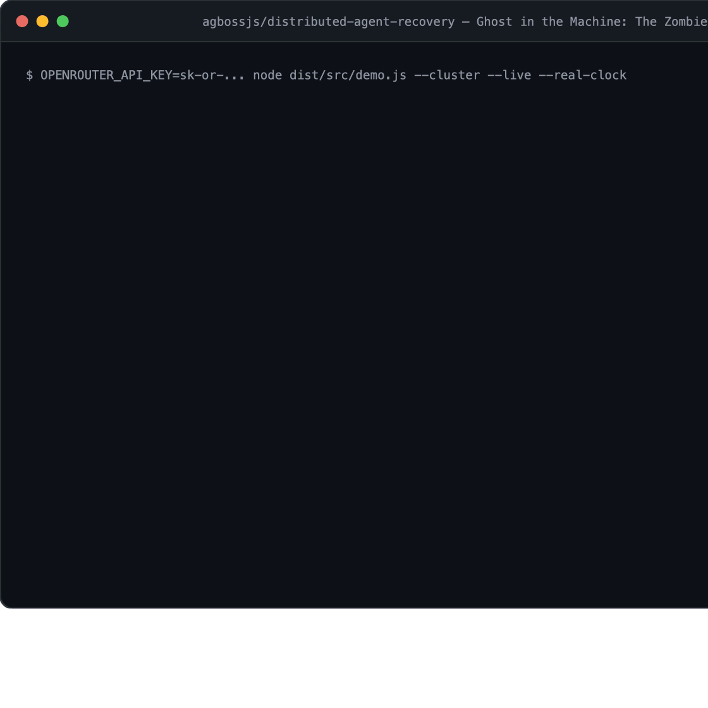
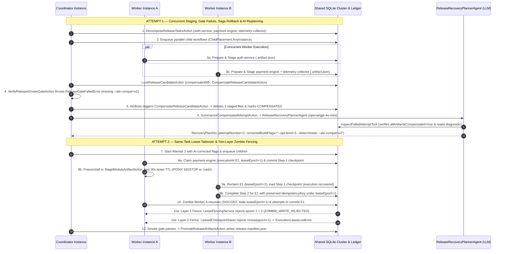

# Distributed Agent Recovery — AGBoss Showcase

> **Ghost in the Machine: The Zombie AI Worker**  
> *It lost its lease. Another worker took over. Then the zombie came back.*  
> **The worker didn't survive. The workflow did.**

An open-source distributed AI workflow recovery showcase built with [`@agboss/core@0.1.0`](https://github.com/agbossjs/agboss) and [`@agboss/cli@0.1.0`](https://agboss.dev) for the **DEV Community Hacktoberfest Open-Source AI Challenge: Ghost in the Machine**.

- **Official Documentation Walkthrough**: [agboss.dev/examples/distributed-agent-recovery/](https://agboss.dev/examples/distributed-agent-recovery/)
- **Contest Article Draft**: [`ARTICLE.md`](ARTICLE.md)
- **Recorded Live LLM + Real-Clock OS `SIGSTOP` Evidence**: [`docs/evidence/live-real-clock-cluster-run.json`](docs/evidence/live-real-clock-cluster-run.json) · [`docs/evidence/live-real-clock-cluster-runtime.log`](docs/evidence/live-real-clock-cluster-runtime.log)



---

## Why This Showcase Exists

When teams move AI agents from single-process notebooks into multi-worker production pipelines, two failure modes inevitably appear:

1. **Partial Commits Before a Gate Failure**: Multiple worker nodes stage real external artifacts concurrently, and a downstream integration check fails. Without deterministic **Saga Compensation** (`@Action({ compensateWith })`), orphaned artifacts corrupt the next attempt—and asking an LLM to clean up half-committed files via tool calls is non-deterministic and unsafe.
2. **The Zombie Worker (GC Pause / I/O Stall / Container Freeze)**: Worker A starts a task under `leaseEpoch = 1`, checkpoints Step 1, and stalls during Step 2 until its execution lease expires. Worker B claims the orphaned execution under `leaseEpoch = 2`, resumes from Worker A's Step 1 checkpoint, and commits the task. **Then Worker A wakes up and tries to commit its stale continuation.**

This repository demonstrates—with real OS worker processes, Docker Compose containers, a single-node Kubernetes (`kind`) deployment, real filesystem artifacts, a shared SQLite WAL cluster database, and an automated 8-invariant verifier—how **AGBoss** and application-level transactional fencing work together while keeping **AI reasoning** (`ReleaseRecoveryPlannerAgent`) strictly separated from **deterministic distributed systems guarantees**.

---

## End-to-End 12-Step Scenario Architecture



---

## Verified Live LLM + Real-Clock POSIX `SIGSTOP` Evidence

In addition to deterministic offline tests, [`docs/evidence/live-real-clock-cluster-run.json`](docs/evidence/live-real-clock-cluster-run.json) and [`docs/evidence/live-real-clock-cluster-runtime.log`](docs/evidence/live-real-clock-cluster-runtime.log) capture a full multi-process execution (`node dist/src/demo.js --cluster --live --real-clock`) with untouched 30-second AGBoss lease sweeps, real POSIX `SIGSTOP` / `SIGCONT` worker process freezing, and live OpenRouter inference:

| Metric | Recorded Value ([`live-real-clock-cluster-run.json`](docs/evidence/live-real-clock-cluster-run.json)) |
|---|---|
| **Execution Mode** | `mode: "live-openrouter"`, `clockMode: "real-30s-clock"`, `faultMode: "os-sigstop-natural-lease-expiry"` |
| **OS Processes** | Coordinator `PID 2768` + Worker `PID 2772` (`2cfa9c79-...`) + Worker `PID 2783` (`bfa0c7de-...`) |
| **Attempt 1 (`executionId`)** | `2be7d7f8-c575-4846-b261-c1ef4aea5e93` -> `ReleaseGateFailedError` -> `compensationsCount: 1` (3 files deleted) |
| **Live LLM Spend (`openai/gpt-4o-mini`)** | `calls: 2` (`InspectFailedAttemptTool` + structured `RecoveryPlanDto`), `1,705` in / `178` out tokens, **`$0.00036255`** (`~$0.000363`, `servedBy: ["OpenAI"]`) |
| **Attempt 2 (`executionId`)** | `bbd3d722-6ab2-4493-94c1-177e49035dd9` -> `PROMOTED` (`3` modules) |
| **Recovered Child Execution** | `f9907abf-19fd-498b-8397-49152e25345f` (`rel-2026.10.0:payment-engine`), Step 1 on `bfa0c7de-...` (`epoch=1`), reclaimed from checkpoint `[execution.recovered]` on `2cfa9c79-...` (`epoch=2`) |
| **AGBoss Core Table Proof** | `execution_leases`: `lease_epoch = 2`, `holder = 2cfa9c79-...`, `released = 1`; `checkpoints`: `6` rows in a single unbranched `parent_checkpoint_id` chain (`noZombieFork: true`); `child_execution_queue`: `0` stuck rows |

---

## Quickstart

### Prerequisites

- **Node.js `>= 22.13.0`** (uses built-in `node:sqlite`; CI and Docker images run on Node.js 24)
- **npm**
- *(Optional)* **Docker & Docker Compose** (or `kind` + `kubectl`) for containerized cluster runs
- *(Optional)* `OPENROUTER_API_KEY` for live LLM inference (`openai/gpt-4o-mini`, statically declared on [`ReleaseRecoveryPlannerAgent`](src/agents/release-recovery-planner/release-recovery-planner.agent.ts))

### 1. Recommended First-Time Developer Workflow (100% Offline Default, `$0`)

No API key or external database is required for the default workflow. Offline runs use a deterministic OpenRouter transport stub (`scenarios/offline-openrouter-fetch.ts`) so tests and multi-process cluster runs execute at `$0` cost:

```bash
npm ci
npm run check
npm test
npm run demo:cluster
npm run verify
```

What each command does:
- `npm ci` — installs locked dependencies cleanly.
- `npm run check` — runs `agboss check` (compile-time verification of `@Application`, `@Workflow`, `@Agent`, `@Action`, `@Tool`, `@HealthCheck`, `@Budget`, environment bindings, prompts, and worst-case concurrency bounds), `tsc --noEmit`, and `eslint .` (`@agboss/core/eslint` + `typescript-eslint`).
- `npm test` — runs the Vitest unit and workflow suite (`@agboss/core/testing`).
- `npm run demo:cluster` — spawns **two independent OS worker processes** ([`worker/main.ts`](worker/main.ts)) plus the coordinator sharing `.data/demo/cluster-state.sqlite` in WAL mode and runs the full 12-step recovery scenario. (Use `npm run demo` for the single-process multi-instance variant.)
- `npm run verify` — runs the standalone 8-invariant verifier (`INV-1` through `INV-8`) against `.data/demo/cluster-state.sqlite` and `.data/demo/artifacts`.

### 2. Offline Mode vs. Live LLM Mode (OpenRouter)

- **Offline Mode (Default)**: All `test` and `demo` scripts default to deterministic offline transport (`mode: "deterministic-offline"`, `$0` spend).
- **Live OpenRouter Mode (`--live` / `demo:live`)**: Pass `OPENROUTER_API_KEY` to execute real inference via AGBoss's `OpenRouterModelProvider` against `ReleaseRecoveryPlannerAgent`'s statically declared `model: "openai/gpt-4o-mini"`. The live agent calls [`InspectFailedAttemptTool`](src/tools/inspect-failed-attempt.tool.ts) against SQLite to confirm Attempt 1 compensation before returning a typed [`RecoveryPlanDto`](src/dto/recovery-plan.dto.ts):

```bash
# Single-command live OpenRouter run:
OPENROUTER_API_KEY="sk-or-v1-..." npm run demo:live
```

### 3. Real-Clock POSIX `SIGSTOP` / `SIGCONT` Multi-Process Mode

By default, `npm run demo:cluster` uses `FastClusterClock` (~3s total runtime) for rapid local feedback. To run compiled production artifacts with **untouched 30-second AGBoss lease sweeps and real POSIX `SIGSTOP`/`SIGCONT` OS worker freezing**:

```bash
npm run build
node dist/src/demo.js --cluster --real-clock

# Combine multi-process real-clock POSIX SIGSTOP with live OpenRouter inference:
OPENROUTER_API_KEY="sk-or-v1-..." node dist/src/demo.js --cluster --live --real-clock
```

### 4. Automated Vitest Suite Details

`npm test` executes four test suites mirroring `src/`:
- [`tests/tools/inspect-failed-attempt.tool.test.ts`](tests/tools/inspect-failed-attempt.tool.test.ts) — Isolated `@Tool` and `@Action` unit runner verification (`testTool`, `testAction`).
- [`tests/health-checks/release-cluster.health-check.test.ts`](tests/health-checks/release-cluster.health-check.test.ts) — `checkLiveness()` & `checkReadiness()` verification via `testWith`.
- [`tests/workflows/module-worker/module-worker.workflow.test.ts`](tests/workflows/module-worker/module-worker.workflow.test.ts) — Same-task takeover (`task-001`), two-layer zombie worker fencing, and direct assertions on AGBoss's `execution_leases`, `checkpoints`, and `child_execution_queue` tables.
- [`tests/workflows/release-coordinator/release-coordinator.workflow.test.ts`](tests/workflows/release-coordinator/release-coordinator.workflow.test.ts) — `testWith` saga compensation + `mockLlm(ReleaseRecoveryPlannerAgent)` tool-call proof + full 12-step 8-invariant end-to-end test.

### 5. Run with Docker Compose or Local Kubernetes (`kind`)

```bash
# 4-container Docker Compose cluster (storage-init + worker-alpha + worker-beta + coordinator):
npm run demo:compose

# Explicit cleanup if you run docker compose manually or interrupt a run (stops containers & deletes named volume):
docker compose -f deploy/compose/docker-compose.yml down -v --remove-orphans

# Optional single-node Kubernetes (kind) Deployment (replicas=2) + Coordinator Job:
docker build -t agboss/distributed-agent-recovery:latest -f deploy/compose/Dockerfile .
kind create cluster --name agboss-kind
kind load docker-image agboss/distributed-agent-recovery:latest --name agboss-kind
kubectl apply -f deploy/kubernetes/local-cluster.yaml

# Clean up the local kind cluster when finished:
kind delete cluster --name agboss-kind
```

---

## Automated GitHub Actions CI Gates ([`.github/workflows/ci.yml`](.github/workflows/ci.yml))

Every push and pull request runs three independent verification jobs:

1. **`verify` (Static Check, Vitest & Real-Clock POSIX `SIGSTOP` Multi-Process Gate)**: Runs `agboss check`, `tsc`, `eslint`, `vitest`, fast multi-process cluster mode, **and** `node dist/src/demo.js --cluster --real-clock` (real 30s lease TTL + POSIX `SIGSTOP`/`SIGCONT` freeze), uploading the JSON verification report as a CI artifact.
2. **`docker-compose` (4-Container Cluster & Hard Worker-Crash `exit 137` Gate)**: Builds and runs `deploy/compose/docker-compose.yml` verifying all 8 invariants, then runs a second chaos pass with `AGBOSS_CRASH_WORKER_ON_STALL=true` where one worker container abruptly terminates (`exit 137`) mid-step and verifies that the surviving worker container recovers the orphaned execution from its Step 1 checkpoint without hanging or corrupting state.
3. **`kubernetes-kind` (Single-Node Kubernetes Manifest Gate)**: Spins up a real `kind` Kubernetes cluster, deploys [`deploy/kubernetes/local-cluster.yaml`](deploy/kubernetes/local-cluster.yaml) (`Deployment/agboss-worker` with `replicas: 2` + `Job/agboss-release-coordinator`), and verifies all 8 invariants.

---

## The 8 Automated Invariants (`npm run verify`)

[`ReleaseInvariantVerifierService`](src/services/release-invariant-verifier.service.ts) inspects **both** the application's SQLite ledger tables (`release_artifacts`, `release_candidate_locks`, `fencing_tokens`, `ledger_events`), **AGBoss's internal cluster tables** (`execution_leases`, `checkpoints`, `child_execution_queue`) via [`ClusterSnapshotRepository`](src/repositories/cluster-snapshot.repository.ts), and the filesystem artifact directory:

| # | Invariant ID | What It Proves |
|---|---|---|
| 1 | `INV-1-ALL-MODULES-COMPLETED` | Every expected module (`auth-service`, `payment-engine`, `telemetry-collector`) reached `PROMOTED` status in Attempt 2. |
| 2 | `INV-2-FINAL-ARTIFACTS-EXIST` | `release-manifest.json` and all 3 promoted `*.manifest.json` files exist on disk and match ledger records. |
| 3 | `INV-3-NO-FAILED-ATTEMPT-ARTIFACTS-ACTIVE` | Zero Attempt 1 rows remain active in SQLite and zero Attempt 1 `.artifact.json` staging files remain on disk. |
| 4 | `INV-4-SAGA-COMPENSATIONS-RECORDED-AND-APPLIED` | `CompensateReleaseCandidateAction` marked Attempt 1's candidate lock and all 3 module artifacts `COMPENSATED` with its step idempotency key. |
| 5 | `INV-5-NO-DUPLICATE-EXTERNAL-COMMITS` | Every committed row has a unique step idempotency key and at most one active artifact exists per `(release_id, attempt_number, logical_task_id)`. |
| 6 | `INV-6-MULTI-INSTANCE-PARTICIPATION` | At least 2 distinct AGBoss worker `instanceId`s executed child workflows across the fixed worker pool. |
| 7 | `INV-7-ZOMBIE-WORKER-FENCED` | Verifies Layer 1 (`ZOMBIE_WRITE_REJECTED`) and Layer 2 (`RUNTIME_LEASE_FENCED` when zombie resumes, or hard process death) **plus independent verification of AGBoss's `execution_leases` (`lease_epoch >= 2`, `holder_instance_id !== stalledInstanceId`, `released = 1`) and `checkpoints` (strictly linear unbranched `parent_checkpoint_id` chain proving zero split-brain zombie checkpoint writes)**. |
| 8 | `INV-8-ORIGINAL-LOGICAL-TASK-COMPLETED-AFTER-TAKEOVER` | `rel-2026.10.0:payment-engine` preserved the **exact same `childExecutionId` and `idempotencyKey`**, with Step 1 prepared by Worker A (`leaseEpoch = 1`), Step 2 completed by Worker B (`leaseEpoch = 2`), AGBoss `execution_leases.holder_instance_id` matching the committer, and `0` orphaned rows in `child_execution_queue`. |

> **Internal-Schema Diagnostic Note**: [`ClusterSnapshotRepository`](src/repositories/cluster-snapshot.repository.ts) reads AGBoss's internal SQLite tables (`execution_leases`, `checkpoints`, `child_execution_queue`) directly so `INV-7` and `INV-8` can independently audit lease epochs and checkpoint ancestry. This direct table access is a **verification-only diagnostic dependency** coupled to the internal SQLite schema of `@agboss/core@0.1.0`, **not a recommended application integration API**.

---

## Responsibility Boundaries & Shared Storage Scope

- **Two-Layer Guarantee Boundary (AGBoss vs. Application Ledger)**:
  - **AGBoss Runtime** orchestrates deterministic LIFO `compensateWith` / `.onError(...)` execution inside active workflow runs before routing errors, manages 30-second execution lease ownership and expired-lease reclamation (`SqliteExecutionLeaseRepository`), resumes recovered executions from their last committed LangGraph checkpoint, and fences stale checkpoint writes via `LeasedCheckpointSaver.putWrites()` (`ExecutionLeaseLostError`).
  - **Application Actions & SQLite Ledger** ([`CompensateReleaseCandidateAction`](src/actions/compensate-release-candidate.action.ts), [`LeaseFencingService`](src/services/lease-fencing.service.ts), [`ReleaseLedgerService`](src/services/release-ledger.service.ts)) enforce external side-effect idempotency (`step.idempotencyKey`), transactional `leaseEpoch` fencing before writing artifacts, and physical deletion of staged Attempt 1 files—which [`InspectFailedAttemptTool`](src/tools/inspect-failed-attempt.tool.ts) explicitly verifies before the LLM plans Attempt 2.
- **At-Least-Once Step Execution with Idempotent Effects & Fencing (Not "Exactly-Once")**: Lease takeover executes workflow steps *at-least-once*: when a worker stalls or crashes mid-step after checkpointing Step 1, a surviving worker replays Step 2 from that checkpoint. Duplicate external commits are prevented not by claiming "exactly-once execution," but by combining deterministic per-step idempotency keys (`<executionId>:<nodeId>:<visitNumber>`) with monotonic `leaseEpoch` fencing in the application ledger.
- **Compensation Scope & Hard-Kill Recovery**: Saga compensation only undoes *reversible* operations (such as deleting staged release candidate files prior to final promotion) when an active workflow encounters a downstream failure (`ReleaseGateFailedError`); it cannot automatically undo arbitrary irreversible external effects (which must be deferred behind a commit gate or outbox). Likewise, a hard-killed worker process (`SIGKILL` / `exit 137`) does not execute in-process compensation on death—instead, its lease expires and a surviving worker resumes the unfinished child execution from its last checkpoint.
- **Fixed Worker Pool vs. Autoscaling**: This showcase demonstrates work distribution and failover across a fixed pool of worker processes/pods (`ChildPlacement.AnyInstance`), not dynamic horizontal autoscaling.
- **Single-Host Shared SQLite WAL Scope**: Multiple processes, Docker Compose containers, or single-node `kind` Kubernetes pods share a local SQLite database in `WAL` mode. Single-host shared SQLite WAL provides a zero-dependency reproducible cluster environment relying on host-kernel file locks; multi-node distributed deployments across separate hosts require network-backed storage repositories (such as PostgreSQL) implementing the same monotonic `leaseEpoch` fencing contract.

---

## Repository Structure

Every directory under `src/` strictly follows `<kind>/<name>.<kind>.<ext>` (one class per file, `< 200` lines per file, Drizzle ORM repositories in `src/repositories/`, Drizzle table schemas in `src/schemas/`, and pure `.sql` DDL in `src/sql/`):

```text
distributed-agent-recovery/
├── src/
│   ├── distributed-agent-recovery.application.ts  # @Application root assembly & DI bindings
│   ├── demo.ts                                    # CLI demo & invariant verification entrypoint
│   ├── environments/                              # *.environment.ts (App, dev, test)
│   ├── budgets/                                   # *.budget.ts (@Budget cost guardrails)
│   ├── dto/                                       # *.dto.ts (one @agboss/core/dto class per file)
│   ├── errors/                                    # *.error.ts (AGBossError subclasses)
│   ├── sql/                                       # *.sql (SQLite DDL schema migrations)
│   ├── schemas/                                   # *.schema.ts (Drizzle ORM sqliteTable schemas)
│   ├── repositories/                              # *.repository.ts (Drizzle ORM & AGBoss SQLite repos)
│   ├── services/                                  # *.service.ts (stateless @Injectable domain services)
│   ├── actions/                                   # *.action.ts (stateless @Action steps & saga compensation)
│   ├── agents/release-recovery-planner/           # @Agent (openai/gpt-4o-mini) + prompt.md
│   ├── tools/inspect-failed-attempt.tool.ts       # @Tool querying SQLite ledger diagnostics
│   ├── workflows/                                 # ReleaseCoordinator & ModuleWorker @Workflow graphs
│   └── health-checks/                             # *.health-check.ts (@HealthCheck readiness probe)
├── worker/
│   └── main.ts                                    # Standalone worker process (cluster / Docker / K8s)
├── scenarios/                                     # 12-step pipeline runner & offline demo transport
├── tests/                                         # Vitest suite mirroring src/ (@agboss/core/testing)
├── deploy/                                        # Docker Compose & single-node kind/k3d manifests
├── docs/
│   ├── assets/                                    # Terminal demo GIF & SVG
│   └── evidence/                                  # Recorded live OpenRouter + real-clock SIGSTOP proof
└── ARTICLE.md                                     # DEV.to Hacktoberfest challenge submission article
```

## License

Apache-2.0 — see [LICENSE](LICENSE).
