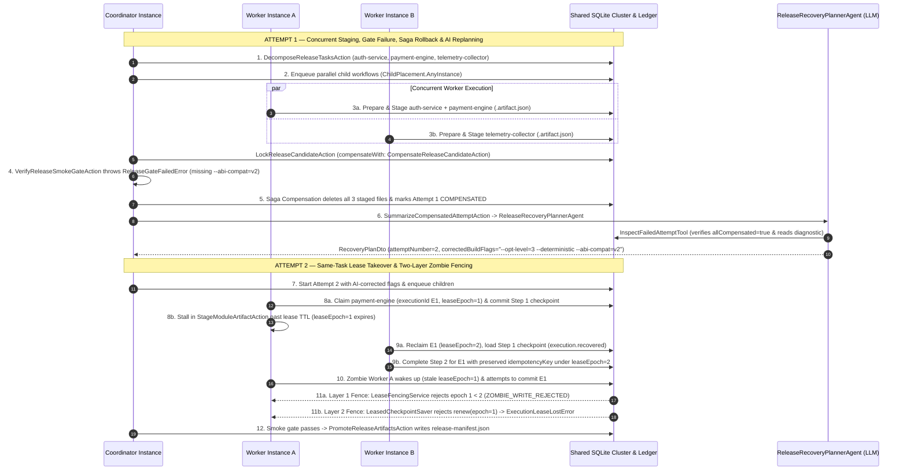

# Distributed Agent Recovery — AGBoss Showcase

> **Ghost in the Machine: The Zombie AI Worker**  
> *It lost its lease. Another worker took over. Then the zombie came back.*  
> **The worker didn't survive. The workflow did.**

An open-source distributed AI workflow recovery showcase built with [`@agboss/core@0.1.0`](https://github.com/agbossjs/agboss) and [`@agboss/cli@0.1.0`](https://agboss.dev) for the **DEV Community Hacktoberfest Open-Source AI Challenge: Ghost in the Machine**.

---

## Why This Showcase Exists

When teams move AI agents from single-process notebooks into multi-worker production pipelines, two failure modes inevitably appear:

1. **Partial Commits Before a Gate Failure**: Multiple worker nodes stage real external artifacts concurrently, and a downstream integration check fails. Without deterministic **Saga Compensation** (`@Action({ compensateWith })`), orphaned artifacts corrupt the next attempt—and asking an LLM to clean up half-committed files via tool calls is non-deterministic and unsafe.
2. **The Zombie Worker (GC Pause / I/O Stall / Container Freeze)**: Worker A starts a task under `leaseEpoch = 1`, checkpoints Step 1, and stalls during Step 2 until its execution lease expires. Worker B claims the orphaned execution under `leaseEpoch = 2`, resumes from Worker A's Step 1 checkpoint, and commits the task. **Then Worker A wakes up and tries to commit its stale continuation.**

This repository demonstrates—with real OS processes, real filesystem artifacts, a shared SQLite WAL cluster database, and an automated 8-invariant verifier—how **AGBoss** handles both failure modes while keeping **AI reasoning** (`ReleaseRecoveryPlannerAgent`) strictly separated from **deterministic distributed systems guarantees** (leases, checkpoint recovery, idempotency keys, and saga rollbacks).

---

## End-to-End 12-Step Scenario Architecture



---

## Quickstart

### Prerequisites

- **Node.js `>= 22.13.0`** (uses built-in `node:sqlite`)
- **npm**
- *(Optional)* **Docker & Docker Compose** for multi-container execution
- *(Optional)* `OPENROUTER_API_KEY` for live LLM execution (`openai/gpt-4o-mini`, statically declared on `ReleaseRecoveryPlannerAgent`)

### 1. Install & Statically Verify the AGBoss Application

```bash
npm install
npm run check
```

`npm run check` runs:
- `agboss check` — statically verifies the `@Application`, `@Workflow`, `@Agent`, `@Action`, `@Tool`, `@HealthCheck`, `@Budget`, environment bindings, prompts, and worst-case execution bounds.
- `tsc --noEmit` — strict TypeScript typechecking.
- `eslint .` — `@agboss/core/eslint` (`agboss/no-component-state`, `agboss/no-direct-time`, `FLOW_CHAIN_RULE`) + `typescript-eslint`.

### 2. Run the Full 12-Step Demo & Automated 8-Invariant Verifier (100% Offline Default)

```bash
npm run demo
npm run verify
```

Runs the complete two-attempt pipeline offline ($0) and verifies all 8 invariants (`INV-1` through `INV-8`).

### 3. Run with a Live LLM Provider (OpenRouter)

```bash
OPENROUTER_API_KEY="sk-or-v1-..." npm run demo:live
```

Uses AGBoss's built-in `OpenRouterModelProvider` directly against OpenRouter with `ReleaseRecoveryPlannerAgent`'s statically declared `model: "openai/gpt-4o-mini"`. The live agent invokes `InspectFailedAttemptTool` against the SQLite ledger to confirm Attempt 1 compensation before returning the structured `RecoveryPlanDto`.

### 4. Run the Multi-Process OS Cluster Demo

```bash
npm run demo:cluster

# Or run compiled production artifacts with untouched 30s AGBoss sweeps & POSIX SIGSTOP/SIGCONT freeze:
npm run build
node dist/src/demo.js --cluster --real-clock
```

Spawns **two independent OS worker processes** (`worker/main.ts` or compiled `dist/worker/main.js`) plus the coordinator sharing `.data/demo/cluster-state.sqlite` in WAL mode, executes the full 12-step scenario across OS processes, and verifies all 8 invariants. Pass `--live` alongside `OPENROUTER_API_KEY` to combine multi-process execution with live OpenRouter inference.

### 5. Run the Automated Vitest Suite

```bash
npm test
```

Runs the `@agboss/core/testing` unit and workflow test suite mirroring `src/`:
- [`tests/tools/inspect-failed-attempt.tool.test.ts`](tests/tools/inspect-failed-attempt.tool.test.ts) — Isolated `@Tool` and `@Action` unit runner verification (`testTool`, `testAction`).
- [`tests/health-checks/release-cluster.health-check.test.ts`](tests/health-checks/release-cluster.health-check.test.ts) — `checkLiveness()` & `checkReadiness()` verification via `testWith`.
- [`tests/workflows/module-worker/module-worker.workflow.test.ts`](tests/workflows/module-worker/module-worker.workflow.test.ts) — P0 same-task takeover (`task-001`) & two-layer zombie worker fencing proof.
- [`tests/workflows/release-coordinator/release-coordinator.workflow.test.ts`](tests/workflows/release-coordinator/release-coordinator.workflow.test.ts) — `testWith` saga compensation + `mockLlm(ReleaseRecoveryPlannerAgent)` tool-call proof + full 12-step 8-invariant end-to-end test.

### 6. Run with Docker Compose (Multi-Container Cluster)

```bash
npm run demo:compose
```

Starts `storage-init`, two independent worker containers (`worker-alpha`, `worker-beta`), and the `coordinator` container sharing a named Docker volume (`/data`).

---

## The 8 Automated Invariants (`npm run verify`)

[`src/services/release-invariant-verifier.service.ts`](src/services/release-invariant-verifier.service.ts) inspects the shared SQLite database (`release_artifacts`, `release_candidate_locks`, `fencing_tokens`, `execution_leases`, `ledger_events`) via [`ReleaseArtifactRepository`](src/repositories/release-artifact.repository.ts) (Drizzle ORM) and the filesystem artifact directory to verify:

| # | Invariant ID | What It Proves |
|---|---|---|
| 1 | `INV-1-ALL-MODULES-COMPLETED` | Every expected module (`auth-service`, `payment-engine`, `telemetry-collector`) reached `PROMOTED` status in Attempt 2. |
| 2 | `INV-2-FINAL-ARTIFACTS-EXIST` | `release-manifest.json` and all 3 promoted `*.manifest.json` files exist on disk and match ledger records. |
| 3 | `INV-3-NO-FAILED-ATTEMPT-ARTIFACTS-ACTIVE` | Zero Attempt 1 rows remain active in SQLite and zero Attempt 1 `.artifact.json` staging files remain on disk. |
| 4 | `INV-4-SAGA-COMPENSATIONS-RECORDED-AND-APPLIED` | `CompensateReleaseCandidateAction` marked Attempt 1's candidate lock and all 3 module artifacts `COMPENSATED` with its step idempotency key. |
| 5 | `INV-5-NO-DUPLICATE-EXTERNAL-COMMITS` | Every committed row has a unique step idempotency key and at most one active artifact exists per `(release_id, attempt_number, logical_task_id)`. |
| 6 | `INV-6-MULTI-INSTANCE-PARTICIPATION` | At least 2 distinct AGBoss worker `instanceId`s executed child workflows across the cluster. |
| 7 | `INV-7-ZOMBIE-WORKER-FENCED` | Both Layer 1 (`ZOMBIE_WRITE_REJECTED` at the SQLite ledger) and Layer 2 (`RUNTIME_LEASE_FENCED` / `execution.lease-lost` at `LeasedCheckpointSaver`) were recorded for the stalled worker. |
| 8 | `INV-8-ORIGINAL-LOGICAL-TASK-COMPLETED-AFTER-TAKEOVER` | `rel-2026.10.0:payment-engine` preserved the **exact same `childExecutionId` and `idempotencyKey`**, with Step 1 prepared by Worker A (`leaseEpoch = 1`) and Step 2 completed by Worker B (`leaseEpoch = 2`). |

---

## Two-Layer Zombie Worker Fencing Explained

1. **Layer 1 — Application External Side-Effect Boundary ([`LeaseFencingService`](src/services/lease-fencing.service.ts) & [`ReleaseLedgerService`](src/services/release-ledger.service.ts))**:
   AGBoss's `LeaseFence` renews and checks execution leases whenever a workflow step finishes and writes its LangGraph checkpoint (`LeasedCheckpointSaver.putWrites`). Because an `@Action` performs external side effects *during* its `execute()` method—before returning to LangGraph—`StageModuleArtifactAction` captures the active `leaseEpoch` at step entry and passes it as a fencing token to `ReleaseLedgerService.stageModuleArtifact()`. When Worker A stalls and Worker B reclaims the lease (`leaseEpoch = 2`), Worker A's late write carries `capturedLeaseEpoch = 1 < activeLeaseEpoch = 2`. The SQLite transaction rejects the write, records `ZOMBIE_WRITE_REJECTED`, and throws `StaleLeaseFenceError`.
2. **Layer 2 — AGBoss Runtime Checkpoint Boundary (`LeasedCheckpointSaver` & `LeaseFence`)**:
   When the zombie worker catches `StaleLeaseFenceError` and returns control to the AGBoss workflow runner, LangGraph attempts to persist the step's state transition via `LeasedCheckpointSaver.putWrites()`. That calls `ExecutionLeaseRepository.renew({ executionId, instanceId: workerA, leaseEpoch: 1 })`, which returns `false` (recording `RUNTIME_LEASE_FENCED`) and throws `ExecutionLeaseLostError` (`code: "execution.lease-lost"`), halting Worker A's stale execution cleanly.

---

## Shared Storage Scope Note

This showcase uses AGBoss's SQLite-backed cluster repositories (`SqliteChildExecutionQueueRepository`, `SqliteExecutionLeaseRepository`, `SqliteCheckpointSaver`, `SqliteExecutionRecordRepository`, `SqliteExecutionTreeRepository`) and an application-level SQLite ledger sharing a local database file in `WAL` mode across multiple processes or containers on a single host. Single-host shared SQLite WAL provides a zero-dependency local multi-process and Docker Compose setup; in multi-host production deployments, the same repository contracts and monotonic `leaseEpoch` fencing pattern map directly to PostgreSQL.

---

## Repository Structure

Every directory under `src/` strictly follows `<kind>/<name>.<kind>.<ext>` (one class per file, `< 200` lines per file, Drizzle ORM repositories in `src/repositories/`, Drizzle table schemas in `src/schemas/`, and pure `.sql` DDL in `src/sql/`):

```text
distributed-agent-recovery/
├── src/
│   ├── distributed-agent-recovery.application.ts  # @Application root assembly & DI bindings
│   ├── demo.ts                                    # CLI demo & invariant verification entrypoint
│   ├── environments/                              # *.environment.ts (App, dev, test)
│   ├── budgets/                                   # *.budget.ts (@Budget cost guardrails)
│   ├── dto/                                       # *.dto.ts (one @agboss/core/dto class per file)
│   ├── errors/                                    # *.error.ts (AGBossError subclasses)
│   ├── sql/                                       # *.sql (SQLite DDL schema migrations)
│   ├── schemas/                                   # *.schema.ts (Drizzle ORM sqliteTable schemas)
│   ├── repositories/                              # *.repository.ts (Drizzle ORM & AGBoss SQLite repos)
│   ├── services/                                  # *.service.ts (stateless @Injectable domain services)
│   ├── actions/                                   # *.action.ts (stateless @Action steps & saga compensation)
│   ├── agents/release-recovery-planner/           # @Agent (openai/gpt-4o-mini) + prompt.md
│   ├── tools/inspect-failed-attempt.tool.ts       # @Tool querying SQLite ledger diagnostics
│   ├── workflows/                                 # ReleaseCoordinator & ModuleWorker @Workflow graphs
│   └── health-checks/                             # *.health-check.ts (@HealthCheck readiness probe)
├── worker/
│   └── main.ts                                    # Standalone worker process (cluster / Docker / K8s)
├── scenarios/                                     # 12-step pipeline runner & offline demo transport
├── tests/                                         # Vitest suite mirroring src/ (@agboss/core/testing)
├── deploy/                                        # Docker Compose & single-node kind/k3d manifests
└── ARTICLE.md                                     # DEV.to Hacktoberfest challenge article
```

## License

Apache-2.0 — see [LICENSE](LICENSE).
